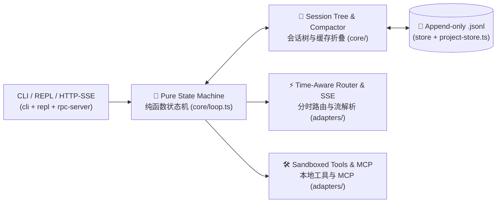

# Duo-Harness Architecture / 全局动态架构图 (ARCH.md)

> 📌 **Rule / 维护铁律**：Keep $\le 8$ diagram nodes and $\le 30$ lines so developers grasp the system in 5s. (严格保持 $\le 8$ 个图节点、$\le 30$ 行正文)。
> 🎯 **Status / 当前进度**：**`Stage 1 ~ Stage 5 All Passed (Pure Loop + .jsonl Tree + Rollback + KV Cache Compactor + MCP + Reviewer & HTTP/SSE)`**

### Module Budget Table / 核心模块职责与行数预算表（File $\le 250$ LOC, `src/core/` Total $\le 500$ LOC）

| Layer / 层级 | Path / 物理路径 | Core Responsibility / 一句话核心职责 (EN / 中文) | Pure / 纯函数 | Status / 状态 |
| :--- | :--- | :--- | :---: | :---: |
| **Core** | `src/core/contracts.ts` | Zod schemas & types for `Message`, `AgentState`, `SessionEntry`, `LoopEvent` (核心数据结构契约) | ✅ 100% | ✅ 119 LOC |
| **Core** | `src/core/loop.ts` | Pure state reducer: `Idle -> Thinking -> AwaitingApproval -> Executing -> Done/Error` (纯状态机步进) | ✅ No I/O | ✅ 158 LOC |
| **Core** | `src/core/session-tree.ts` | Reconstruct branch `messages[]`, auto-heal interrupted `toolCalls` & assert 1:1 pairing (会话树派生与自愈) | ✅ No I/O | ✅ 109 LOC |
| **Core** | `src/core/compactor.ts` | Prefix-locked context compaction folding stale tool outputs (锁死头部前缀、按需折叠旧工具超长输出) | ✅ No I/O | ✅ 88 LOC |
| **Adapter** | `src/adapters/router.ts`, `sse-stream.ts` & `cost-tracker.ts` | Multi-model router, reasoning pass-through, SSE wire capture & cost/cache tracker (路由、流解析与成本账单) | ❌ Network | ✅ 231/154/241 |
| **Adapter** | `src/adapters/store.ts` & `project-store.ts` | `.jsonl` store, 0ms `ReplayProvider` & `~/.duo-harness/projects` isolation (离线回放与多项目中心化存储) | ❌ Disk I/O | ✅ 87/123 LOC |
| **Adapter** | `src/adapters/tools.ts` & `write-tools.ts` | Sandboxed `read_file/list_dir/grep` + batch `edit_file`, `run_bash` & snapshot rollback (读写工具与快照回滚) | ❌ FS/Proc | ✅ 224/227 LOC |
| **Adapter** | `src/adapters/mcp-client.ts` | Standard `stdio` JSON-RPC 2.0 MCP client bridging external tools (标准 MCP 客户端子进程通信) | ❌ Stdio | ✅ 170 LOC |
| **Adapter** | `src/adapters/reviewer.ts` & `xray.ts` | `RepoMap` symbol skeleton, read-only code reviewer & `/xray` payload inspector (自主探路审查与账单透视) | ❌ Review | ✅ 227/219 LOC |
| **Adapter** | `src/adapters/cli.ts`, `repl.ts`, `dropdown.ts`, `ui-logger.ts` & `rpc-server.ts` | Multi-turn runner, interactive REPL (`↑/↓` menu), stage progress tree UI & HTTP/SSE server (终端与服务入口) | ❌ CLI/HTTP | ✅ 240/236/151/144/174 |
