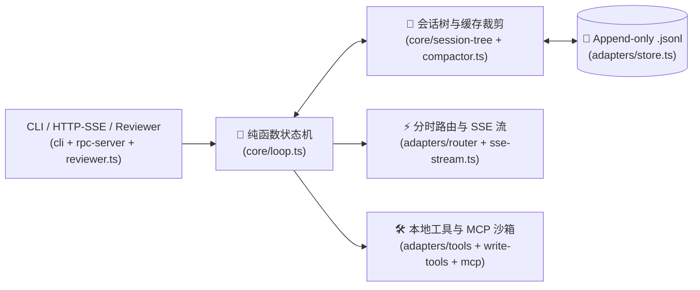

# Duo-Harness 全局动态架构图 (ARCH.md)

> 📌 **维护铁律**：本文件由 AI 每次修改架构后自动同步，严格保持 **$\le 8$ 个图节点、$\le 30$ 行正文**，供人类 5 秒扫图控场。
> 🎯 **当前闯关进度**：**`Stage 1 ~ Stage 5 全关卡通关 (纯函数状态机 + .jsonl 会话树 + 写工具回滚 + KV 缓存压缩 + MCP + 自主探路外审与 HTTP/SSE 接口)`**

### 核心模块职责与行数预算表（单文件上限 $\le 250$ 行，`src/core/` 总计 $\le 500$ 行）

| 层级 | 物理路径 | 一句话核心职责 | 纯函数要求 | 当前状态 |
| :--- | :--- | :--- | :---: | :---: |
| **Core (骨架)** | `src/core/contracts.ts` | 定义 `Message`、`AgentState`、`SessionEntry`、`LoopEvent` 等数据结构 | ✅ 100% 纯类型/Schema | ✅ 已就绪 (119行) |
| **Core (纯内核)** | `src/core/loop.ts` | 驱动 `Idle -> Thinking -> AwaitingApproval -> Executing -> Done/Error` | ✅ 严禁任何 I/O | ✅ 已就绪 (158行) |
| **Core (纯内核)** | `src/core/session-tree.ts` | 顺着 `parentId` 拼出当前分支 `messages[]` + 发请求前配对格式检查 | ✅ 严禁任何 I/O | ✅ 已就绪 (105行) |
| **Core (纯内核)** | `src/core/compactor.ts` | 锁死头部前缀 + 按需增量折叠旧超长工具输出 + 淘汰块保留操作轨迹摘要 | ✅ 严禁任何 I/O | ✅ 已就绪 (108行) |
| **Adapter (外壳)** | `src/adapters/router.ts`, `sse-stream.ts` & `cost-tracker.ts` | 四档分时路由、同轮思考链透传、SSE 抓包与零 Bug 成本缓存统计 | ❌ 隔离网络与计费 | ✅ 已就绪 (245/154/217行) |
| **Adapter (外壳)** | `src/adapters/store.ts` | `.jsonl` 会话文件追加读写 + `createReplayProvider` 断网 0 毫秒回放 | ❌ 隔离硬盘读写 | ✅ 已就绪 (87行) |
| **Adapter (外壳)** | `src/adapters/tools.ts` & `write-tools.ts` | 带行号只读工具、`SKILL.md` 索引注入 + 批量 `edits[]` 写工具与多步回滚 | ❌ 隔离文件与子进程 | ✅ 已就绪 (244/227行) |
| **Adapter (外壳)** | `src/adapters/mcp-client.ts` | 标准 `stdio` JSON-RPC 2.0 客户端，透传 `inputSchema` 转为 `ToolContract` | ❌ 隔离子进程管道 | ✅ 已就绪 (170行) |
| **Adapter (外壳)** | `src/adapters/reviewer.ts` & `xray.ts` | `RepoMap` 骨架图、只读探路外审、Zod 门禁 + 零黑盒字节级 X-Ray 透视台 | ❌ 隔离外审与透视 | ✅ 已就绪 (227/214行) |
| **Adapter (外壳)** | `src/adapters/cli.ts` & `rpc-server.ts` | 子代理 `delegate_task`、`AbortSignal` 级联取消与 HTTP/SSE + `/xray` 接口 | ❌ 隔离终端与 HTTP | ✅ 已就绪 (223/179行) |
