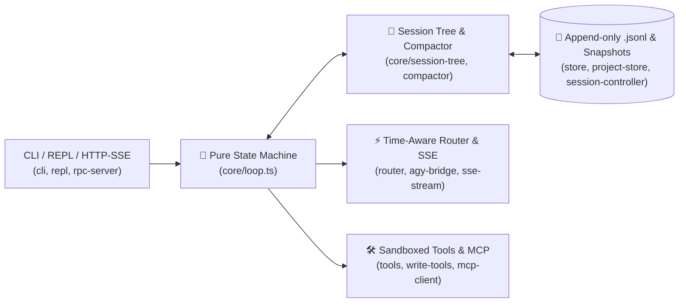

<div align="center">

# Duo-Harness

**Zero-Host-Lock-in TypeScript Coding Agent Runtime & Multi-Project CLI**  
*Functional Core (470 LOC) + Imperative Shell · Branchable `.jsonl` Event Tree · 0ms Offline Replay · KV Prefix-Cache Compaction · MCP Client*

[](https://nodejs.org/)
[](https://www.typescriptlang.org/)
[-brightgreen)](#)
[](https://opensource.org/licenses/MIT)

**[🇬🇧 English](#english)** · **[🇨🇳 简体中文](#简体中文)** ([独立中文文档](./README.zh-CN.md)) · **[🗺️ Architecture](#architecture--module-budget)**

</div>

---

<a id="english"></a>

## 🇬🇧 English

### Why `duo-harness`?

Most AI coding agents today suffer from two extremes: either they are locked inside proprietary IDE extensions, or they are buried under tens of thousands of lines of heavyweight framework abstractions where a single streaming timeout or context-compaction bug takes hours to trace.

**`duo-harness`** is an open-standard, zero-framework-lock-in TypeScript Coding Agent Harness built under strict **Functional Core, Imperative Shell** constraints (`< 2,500 LOC` total, `zod` as the **only** runtime dependency):

- **494-Line Pure Functional Core (`src/core/`)**: Zero `node:fs`, zero `fetch`, zero `child_process`, and zero vendor-specific logic. Every state transition (`Idle -> Thinking -> AwaitingApproval -> Executing -> Done/Error`), `.jsonl` branch projection, dangling `toolCalls` self-healing, and KV-cache-preserving compaction is a 100% deterministic pure function ($\le 250$ lines per file, $\le 80$ lines per function).
- **Production-Ready Multi-Project CLI (`duo` / `pnpm chat`)**: Works across any repository on your machine like Claude Code, Codex CLI, or `@mariozechner/pi-coding-agent`—storing per-project `.jsonl` sessions, file snapshots (`snapshots.json`), and HTTP wire logs cleanly in `~/.duo-harness/projects/<name>-<hash8>/` with **zero untracked files polluting your target repo's `git status`**.

---

### ✨ Key Features

1. **🧅 Pure State Machine with Merged HITL Diff Preview & Self-Verification Gate (`src/core/loop.ts`, `src/adapters/diff-presenter.ts`)**
   - Supports **Human-in-the-Loop (HITL)** suspension before executing mutating tools (`edit_file`, non-readonly `run_bash`), merging concurrent file edits into a single approval card with per-hunk `-removed / +added` LCS diff previews.
   - Built-in **Pre-Complete Verification Gate**: when the model attempts to finish, an external verification hook (`verifyCompletion`) runs automatically; if typecheck/tests fail, `REJECT_COMPLETION` feeds the error back into the loop until all checks pass.
2. **🌳 Append-Only `.jsonl` Session Tree, Crash Auto-Heal & 0ms Offline Replay (`src/core/session-tree.ts`, `src/adapters/store.ts`)**
   - Every message is stored as a tree node with `id` and `parentId`. Switch historical turns with `/resume` (`↑/↓` arrow keys), start a fresh branch with `/new`, or fork from any message ID with `/branch <id>`.
   - Enforces strict 1:1 `toolCalls` $\leftrightarrow$ `toolResult` pairing (`assertSessionInvariant`) and automatically heals interrupted mid-turn tool calls (`repairDanglingToolCalls`) after unexpected crashes or `Ctrl+C`.
   - Includes `ReplayProvider` to replay multi-step tool-calling sessions offline in **0ms with zero API cost**.
3. **⚡ Sticky Multi-Model Router, KV Prefix-Cache Compaction & Cost X-Ray (`src/core/compactor.ts`, `src/adapters/router.ts`, `agy-bridge.ts`, `xray.ts`)**
   - Sticky session-level model lock prevents mid-conversation model switching from invalidating KV prefix caches; supports `/model` (`auto / deepseek / mimo / agy / openai`) and local Antigravity quota probing.
   - Freezes the leading system prompt and early messages byte-for-byte, folding only the oldest oversized tool outputs in-place to preserve **64-token block prefix caching** on DeepSeek / Claude.
   - Built-in `/xray` inspector displays per-round HTTP latency, cached vs. uncached token ratios, and exact cost breakdowns.
4. **💻 Interactive Multi-Project Terminal (`src/adapters/repl.ts`, `session-controller.ts`, `project-store.ts`)**
   - **Live `/` Command Menu & `↑/↓` Interactive Picker**: Type `/` to render a live dropdown menu below the cursor; use `↑/↓` arrows to pick commands, historical turns (`/resume`), or models (`/model`), and press `Tab` to autocomplete paths.
   - **Smart Read-Only Auto-Approval & macOS Seatbelt Kernel Sandbox**: Read-only inspection commands (`git status`, `git diff`, `npx tsc --noEmit`, `ls`, etc.) execute seamlessly without manual prompts inside a macOS `sandbox-exec` kernel profile that blocks any accidental disk writes.
5. **🛡️ Atomic File Writes, Write-Through Snapshots & Multi-Hunk `/diff` + `/undo` (`src/adapters/tools.ts`, `write-tools.ts`, `diff-presenter.ts`)**
   - **POSIX Atomic Writes (`Temp + Rename`) & Write-Through Snapshots**: Every `edit_file` and rollback uses atomic temp-file rename (`writeFileAtomicSync`) and flushes `snapshots.json` immediately per step, preventing 0-byte file truncation or lost undo history on `SIGKILL` / `SIGHUP` / power loss.
   - **Multi-Hunk `/diff` & Turn-Level `/undo`**: Splits multi-region edits in large files into clean anchored diff hunks, prints per-step and end-of-turn `+added / -removed` diffstats, rolls back an entire turn with `/undo` (or `/undo N` / `/undo all`), and automatically injects a `lastUndoNotice` on the next turn so the model knows its previous edits were reverted.
   - Native `stdio` JSON-RPC 2.0 **MCP Client** (`src/adapters/mcp-client.ts`) to mount any external Model Context Protocol server.
6. **🔍 Autonomous Code Reviewer & Dual-End HTTP/SSE Server (`src/adapters/reviewer.ts`, `rpc-server.ts`)**
   - Generates a repository-wide `RepoMap` symbol skeleton, runs static architectural boundary checks, dispatches a read-only agent to trace cross-file callers, and validates structured JSON output via Zod.
   - Native `node:http` server exposing `/health`, `/status`, `/turns`, `/diff`, `/undo`, `/ask`, and `/review` over both JSON and real-time `text/event-stream` (SSE).

---

### 🗺️ Architecture Overview



| Layer | File Path | Core Responsibility |
| :--- | :--- | :--- |
| **Core (Pure)** | `src/core/contracts.ts` | Zod schemas & TypeScript contracts for `Message`, `AgentState`, `SessionEntry`, `LoopEvent`, `LlmStreamEvent` |
| **Core (Pure)** | `src/core/loop.ts` | Pure state reducer driving `Idle -> Thinking -> AwaitingApproval -> Executing -> Done/Error` |
| **Core (Pure)** | `src/core/session-tree.ts` | Reconstructs active branch `messages[]` via `parentId`, auto-heals dangling `toolCalls` & asserts 1:1 pairing |
| **Core (Pure)** | `src/core/compactor.ts` | Prefix-locked context compaction that folds stale tool outputs without invalidating KV caches |
| **Adapter (I/O)** | `src/adapters/repl.ts` / `dropdown.ts` / `diff-presenter.ts` | Interactive CLI (`duo`), live `/` & `↑/↓` picker, multi-hunk LCS diff preview & turn diffstat |
| **Adapter (I/O)** | `src/adapters/session-controller.ts` / `project-store.ts` / `store.ts` | Dual-end session controller (`ask/new/resume/model/diff/undo`), atomic writes & `~/.duo-harness/projects/` store |
| **Adapter (I/O)** | `src/adapters/router.ts` / `agy-bridge.ts` / `sse-stream.ts` | Sticky model router, Antigravity quota bridge, SSE stream bus & `http-wire.json` cost tracker |
| **Adapter (I/O)** | `src/adapters/tools.ts` / `write-tools.ts` / `reviewer.ts` / `rpc-server.ts` | Sandboxed read/write tools, Seatbelt `run_bash`, write-through rollback, autonomous reviewer & HTTP/SSE server |

---

### 🚀 1-Minute Quick Start

#### 1. Install & Run Offline Verification (No API Key Required)

Requires **Node.js >= 22.0.0** and `pnpm`:

```bash
pnpm install

# Run strict TypeScript typecheck + 29 unit, crash-recovery & 0ms offline replay tests (~1s, zero network calls)
pnpm verify
```

#### 2. Configure API Keys (`.env.local` or Environment Variables)

Create a `.env.local` file in the project root (gitignored by default) and provide any of the supported OpenAI-compatible API keys:

```ini
OPENAI_API_KEY=sk-proj-xxxxxxxxxxxxxxxxxxxxxxxxxxxx
DEEPSEEK_API_KEY=sk-xxxxxxxxxxxxxxxxxxxxxxxxxxxxxxxx
MIMO_API_KEY=tp-xxxxxxxxxxxxxxxxxxxxxxxxxxxxxxxx
```

> 💡 **Multi-Model Routing (`src/adapters/router.ts`)**:
> - Supports official **OpenAI API** (`OPENAI_API_KEY` / `OPENAI_MODEL`, defaulting to `gpt-5-codex` and compatible with `gpt-5.6` / `gpt-5`), **DeepSeek**, and **MiMo 2.6**.
> - When both `MIMO_API_KEY` and `DEEPSEEK_API_KEY` are configured, weekday peak hours automatically route to `MiMo 2.6` and off-peak/weekends route to `DeepSeek` with 64-token prefix caching; set `LLM_PROVIDER=openai` or provide `OPENAI_API_KEY` to route directly to OpenAI.

#### 3. Launch Interactive Multi-Project CLI (`pnpm chat` or Global `duo`)

```bash
# Start interactive session in the current workspace
pnpm chat

# Or link `duo` globally to run inside ANY repository on your machine:
pnpm link --global
cd /path/to/any-other-project && duo
```

Inside the `duo>` prompt, type `/` to pop up the live command menu below the cursor, or press `Tab` to autocomplete:

| Slash Command | Description |
| :--- | :--- |
| `/resume` | Select any historical turn (`#1`, `#2`, ...) using `↑/↓` arrow keys to continue or branch |
| `/new` | Start a brand-new conversation while safely preserving previous history in `.jsonl` |
| `/model` | Switch model routing strategy (`auto / deepseek / mimo / agy / openai`) via `↑/↓` picker |
| `/diff` | View multi-hunk LCS code diffs (`-removed / +added`) for all uncommitted file edits |
| `/undo` | Roll back file modifications (`/undo` reverts last turn, `/undo N` reverts N steps, `/undo all` reverts all) |
| `/cd <path>` | Switch active workspace to another repository on disk (sessions isolated under `~/.duo-harness/projects/`) |
| `/projects` | List all repositories you have worked on with their entry count and path |
| `/xray` | Inspect per-round HTTP payloads, latency, KV-cache hit rate, Antigravity quota, and cost breakdown |
| `/history` | View conversation turn list and current active leaf |
| `/branch <id>` | Jump to any historical message ID to fork a new parallel branch |
| `/clear` | Clear current project session history, wire logs, and snapshots |
| `/exit` | Exit interactive REPL |

#### 4. One-Shot CLI, Offline Replay, Autonomous Code Review & HTTP/SSE Server

```bash
# 1. Run live recording + 0ms offline replay + KV cache & cost report demo
pnpm play

# 2. One-shot question (supports --continue to resume and --dir for external repos)
pnpm ask "Read package.json and summarize the scripts"
pnpm ask --dir ../my-other-app "Check src/ for unhandled Promise rejections"

# 3. Run autonomous RepoMap + architectural boundary code reviewer
pnpm review src/core/loop.ts

# 4. Start HTTP JSON / SSE streaming server (defaults to http://127.0.0.1:3210)
pnpm serve
```

---
---

<a id="简体中文"></a>

## 🇨🇳 简体中文

### 为什么构建 `duo-harness`？

市面上的 AI 编程工具大多走向两个极端：要么与特定 IDE 客户端强绑定，要么被几万行重型黑盒框架层层包裹——一旦遇到 SSE 断流、工具配对报错或前缀缓存雪崩，开发者很难看清底层到底发生了什么。

**`duo-harness`** 是一个零黑盒框架依赖、100% 遵循行业开放标准（OpenAI Streaming / MCP JSON-RPC 2.0 / Append-only `.jsonl` 会话树）的轻量级 TypeScript Coding Agent 运行时与跨项目交互式 CLI（全库 `< 2,500 行`，运行时仅依赖 `zod`）：

- **494 行纯函数内核 (`src/core/`)**：零 `node:fs`、零 `fetch`、零 `child_process`、零厂商耦合。所有状态流转（`Idle -> Thinking -> AwaitingApproval -> Executing -> Done/Error`）、`.jsonl` 分支还原、中断悬空 `toolCalls` 自愈与 KV 前缀缓存折叠全部是 100% 确定性纯函数（单文件严格 $\le 250$ 行、单函数 $\le 80$ 行）。
- **零污染多项目交互终端 (`duo` / `pnpm chat`)**：对标 Claude Code、Codex CLI 与 `@mariozechner/pi-coding-agent`，可在电脑任意代码仓库直接启动交互编程与架构审查；所有项目的会话历史、文件修改快照（`snapshots.json`）与网络抓包统一集中存放在 `~/.duo-harness/projects/<项目名>-<哈希>/`，**绝不在目标仓库产生任何未跟踪文件污染 `git status`**。

---

### ✨ 核心特性

1. **🧅 纯函数状态机、合并式 Diff 审批框（HITL）与完成前自动验证打回 (`src/core/loop.ts`, `src/adapters/diff-presenter.ts`)**
   - 写文件或执行非只读命令前自动挂起等待人工确认（Human-in-the-Loop），同一步多个 `edit_file` 自动合并为 1 个审批框并按修改点展示 `-删除 / +新增` LCS 代码对比预览；拒绝时自动生成 1:1 工具回执防止上下文格式损坏。
   - 内置 **Pre-Complete Verification Gate**：模型认为任务完成准备结束时，自动执行外部验证钩子（如类型检查与单测）；若报错则通过 `REJECT_COMPLETION` 自动将报错打回给模型继续修复，直至验证全绿。
2. **🌳 `.jsonl` 分支会话树、半途强关自愈与 0 毫秒断网录像回放 (`src/core/session-tree.ts`, `src/adapters/store.ts`)**
   - 每条消息带 `id` 与 `parentId` 追加写入 `.jsonl`，支持 `/resume`（`↑/↓` 方向键选轮次切换历史）、`/new` 开启新对话、`/branch <节点id>` 切回任意历史节点开辟平行对话分支。
   - 内置 `repairDanglingToolCalls`，即使半途按 `Ctrl+C` 或关掉终端窗口，重启后也会自动补齐悬空的工具调用回执；内置 `ReplayProvider` 支持断网 0 毫秒重放历史对话。
3. **⚡ 会话粘性模型路由、KV 前缀缓存保护与真实耗时/费用账单 (`src/core/compactor.ts`, `src/adapters/router.ts`, `agy-bridge.ts`, `xray.ts`)**
   - 同会话自动锁定当前模型防止跨时段切换打碎前缀缓存，支持 `/model` 手动切换（`auto / deepseek / mimo / agy / openai`）及反重力本地订阅额度探测。
   - 当上下文超限时，仅原地折叠最旧的超长工具返回结果，**100% 锁死头部 System Prompt 与早期消息字节不变**，保护 DeepSeek / Claude 64-Token 块级前缀缓存不雪崩。
   - 内置 `/xray` 诊断面板，实时展示每轮 HTTP 首包耗时、缓存命中 Token 占比与精确到分的费用账单。
4. **💻 多项目交互式终端 (`src/adapters/repl.ts`, `session-controller.ts`, `project-store.ts`)**
   - **`/` 实时下拉选择菜单与 `↑/↓` 方向键交互**：输入 `/` 即在光标下方实时弹出命令菜单，支持用 `↑/↓` 键直接选择历史轮次（`/resume`）或模型（`/model`），按 `Tab` 自动补全路径。
   - **只读命令智能免审放行与 macOS Seatbelt 内核级只读沙箱**：`git status`、`git diff`、`npx tsc --noEmit` 等只读检查命令自动免审放行，并在 macOS 下通过 `sandbox-exec` 内核级沙箱强制拦截任何磁盘写入。
5. **🛡️ 原子写盘、写穿快照（Write-Through）与多段 `/diff` + 整轮 `/undo` (`src/adapters/tools.ts`, `write-tools.ts`, `diff-presenter.ts`)**
   - **POSIX 原子写盘（`Temp + Rename`）与单步实时落盘**：所有文件修改、回退与元数据存储统一采用同目录临时文件原子重命名（`writeFileAtomicSync`），每次 `edit_file` 或 `rollback_version` 当场刷新磁盘 `snapshots.json`，彻底杜绝半途断电或强关 CLI 导致文件变 `0 字节` 或丢失回退记录。
   - **大文件多段锚点 `/diff` 与整轮 `/undo`**：单步与轮末实时打印 `+新增 / -删除` Diffstat 清单（含半途 `Ctrl+C` 中断提示）；900+ 行大文件多处修改自动按未改动锚点切分多段 Hunk 预览；支持 `/undo` 一键撤回整轮修改并在下一轮自动注入 `lastUndoNotice` 提醒模型。
   - 内置标准 `stdio` JSON-RPC 2.0 MCP 客户端（`src/adapters/mcp-client.ts`），可一键挂载任意第三方 MCP Server。
6. **🔍 自主探路代码审查特工与双端 HTTP/SSE 服务 (`src/adapters/reviewer.ts`, `rpc-server.ts`)**
   - 自动扫描全库导出符号生成 `RepoMap` 行号地图 + 静态架构红线检查 + 只读 Agent 自主跨文件追查 + Zod 结构化报告校验。
   - 原生 `node:http` 暴露 `/health`、`/status`、`/turns`、`/diff`、`/undo`、`/ask`、`/review` 接口，支持 JSON 与 `text/event-stream` (SSE) 实时流推送。

---

### 🚀 1 分钟快速上手

#### 1. 安装依赖与运行离线验证（无需 API Key）

要求 `Node.js >= 22.0.0` 并统一使用 `pnpm`：

```bash
pnpm install

# 运行 TypeScript 严格类型检查 + 29 项单元、崩溃恢复与断网回放测试（0 网络请求，耗时 ~1 秒）
pnpm verify
```

#### 2. 配置 API Key（`.env.local` 或环境变量）

在项目根目录创建 `.env.local`（已被 `.gitignore` 忽略），填入任一或两个模型的 API Key：

```ini
DEEPSEEK_API_KEY=sk-xxxxxxxxxxxxxxxxxxxxxxxxxxxxxxxx
MIMO_API_KEY=tp-xxxxxxxxxxxxxxxxxxxxxxxxxxxxxxxx
```

#### 3. 启动交互式命令行（`pnpm chat` 或全局 `duo`）

```bash
# 在当前仓库启动交互式对话（自动记忆上下文）
pnpm chat

# 或者挂载为全局命令 `duo`，即可在电脑任意项目目录下直接运行：
pnpm link --global
cd /path/to/any-other-project && duo
```

在 `duo>` 交互式终端中，输入 `/` 即可在光标下方实时弹出命令选择菜单（支持 `Tab` 自动补全）：

| 快捷命令 | 功能说明 |
| :--- | :--- |
| `/resume` | 用 `↑/↓` 方向键选择历史轮次（`#1`、`#2`...）或切换会话继续追问 |
| `/new` | 开启全新对话（旧历史安全保留在 `.jsonl` 中，随时可 `/resume` 切回） |
| `/model` | 用 `↑/↓` 方向键切换模型策略（`auto / deepseek / mimo / agy / openai`） |
| `/diff` | 查看未撤回的文件修改对比（`-删除 / +新增` 多段锚点预览与行数统计） |
| `/undo` | 撤回文件修改（`/undo` 撤回上一轮 \| `/undo N` 撤回 N 步 \| `/undo all` 全部撤回） |
| `/cd <目录路径>` | 切换到电脑上的任意其他项目目录（按回车直接展开已管理项目列表） |
| `/projects` | 查看所有已管理的项目列表、记录条数与路径 |
| `/xray` | 查看当前会话每轮耗时、缓存命中率、反重力订阅额度与费用账单 |
| `/history` | 查看当前项目所有历史问答列表 |
| `/branch <节点id>` | 从指定历史消息节点分叉开辟平行对话分支 |
| `/clear` | 彻底清空当前项目磁盘历史记录、抓包与快照 |
| `/exit` | 退出交互终端 |

---

## 📄 License / 开源协议

MIT License
