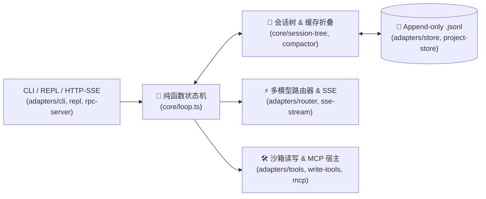

# Duo-Harness

> **Zero-Host-Lock-in TypeScript Agent Harness (`Functional Core + Imperative Shell`, `< 2,500 lines`, `1` runtime dependency: `zod`)**

`duo-harness` 是一个零黑盒框架依赖、100% 遵循行业开放标准（OpenAI Streaming / MCP JSON-RPC 2.0 / Append-only `.jsonl` 会话树）的轻量级 TypeScript Coding Agent 运行时与交互式 CLI。

它将 **470 行纯函数状态机内核（`src/core/`）** 与 **外部 I/O 驱动外壳（`src/adapters/`）** 彻底物理隔离——不仅能像 Claude Code / Codex CLI 一样在终端跨任意项目交互编程、自动探索代码库与审查架构，还能让你在 15 分钟内读懂工业级 Agent Runtime 的每一颗底层螺丝。

---

## ✨ 核心特性

1. **🧅 纯函数内核与 I/O 外壳物理分离 (`src/core/` vs `src/adapters/`)**
   - **`src/core/`（仅 470 行，100% 纯函数）**：零 `node:fs`、零 `fetch`、零 `child_process`、零厂商策略。只负责 `输入纯 JSON 数据 -> 返回下一步动作指令与新状态`，单文件严格 $\le 250$ 行、单函数 $\le 80$ 行。
   - **状态机闭环 (`src/core/loop.ts`)**：`Idle -> Thinking -> AwaitingApproval -> Executing -> Done/Error`，原生支持写操作挂起审批（HITL）与完成前验证不通过自动打回重修（`REJECT_COMPLETION`）。
2. **🌳 `.jsonl` 分支会话树与 0 毫秒断网录像回放 (`src/core/session-tree.ts`, `src/adapters/store.ts`)**
   - 每条消息带 `id` 与 `parentId` 追加写入 `.jsonl`，支持 `/undo` 一键退回上一步、`/branch <id>` 切回任意历史节点开辟平行分支。
   - 内置 `ReplayProvider`，无需 API Key、断网 0 毫秒重放完整多步 Tool Call 历史对话，用于单元测试与回归验证。
3. **⚡ KV 前缀缓存保护与真实耗时/费用账单 (`src/core/compactor.ts`, `src/adapters/cost-tracker.ts`, `xray.ts`)**
   - 当上下文超限时，仅折叠最旧的超长工具返回结果，**100% 锁死头部 System Prompt 与早期消息字节不变**，保护 DeepSeek / Claude 64-Token 块级前缀缓存不雪崩。
   - 内置 `/xray` 诊断面板，实时展示每轮 HTTP 首包耗时、缓存命中 Token 占比与精确到分的费用账单。
4. **💻 零污染多项目交互式终端 (`duo` / `pnpm chat`)**
   - 对标 Claude Code 与 `@mariozechner/pi-coding-agent`：所有项目的对话历史与网络抓包统一集中存放在 `~/.duo-harness/projects/<项目名>-<哈希>/`，**在任何外部仓库运行均不会产生任何未跟踪文件污染 `git status`**。
   - 支持输入 `/` 实时弹出命令下拉菜单、`Tab` 补全路径与命令、只读命令（`git status`/`git diff`/`pnpm test` 等）自动免审放行、写操作与危险命令终端高亮拦截确认。
5. **🛡️ 沙箱工具、事务快照回滚与标准 MCP 客户端 (`src/adapters/tools.ts`, `write-tools.ts`, `mcp-client.ts`)**
   - 内置带行号切片 `read_file`、带上下文 `grep`、`list_dir`、`edit_file` 与进程组级超时清剿 `run_bash`。
   - 写文件自动备份内存快照，一旦中途报错或测试门禁失败自动逆序回滚硬盘文件。
   - 内置标准 `stdio` JSON-RPC 2.0 MCP 客户端，可一键挂载任意第三方 MCP Server。
6. **🔍 自主探路代码审查特工与 HTTP/SSE 服务 (`src/adapters/reviewer.ts`, `rpc-server.ts`)**
   - 自动扫描全库导出符号生成 `RepoMap` 行号地图 + 静态架构红线检查 + 只读 Agent 自主跨文件追查 + Zod 结构化报告校验。
   - 原生 `node:http` 暴露 `/health`、`/ask`、`/review` 接口，支持 JSON 与 `text/event-stream` (SSE) 实时流推送。

---

## 🗺️ 架构全览



| 层级 | 文件路径 | 核心职责 |
| :--- | :--- | :--- |
| **Core (纯内核)** | `src/core/contracts.ts` | 定义 `Message`、`AgentState`、`SessionEntry`、`LlmProvider` 等纯数据结构与 Zod Schema |
| **Core (纯内核)** | `src/core/loop.ts` | 驱动 `Idle -> Thinking -> AwaitingApproval -> Executing -> Done/Error` 纯状态步进 |
| **Core (纯内核)** | `src/core/session-tree.ts` | 顺着 `parentId` 拼出当前分支 `messages[]` + 发请求前 `toolCall` 1:1 配对格式检查 |
| **Core (纯内核)** | `src/core/compactor.ts` | 锁死头部消息不改动、仅把旧的超长工具输出折叠为一行摘要，保护大模型前缀缓存 |
| **Adapter (外壳)** | `src/adapters/repl.ts` / `project-store.ts` | 跨项目交互式终端（`/` 实时下拉菜单、`Tab` 补全、分支回退）与 `~/.duo-harness/projects/` 集中存储 |
| **Adapter (外壳)** | `src/adapters/router.ts` / `sse-stream.ts` | 多模型分时路由（DeepSeek / 小米 MiMo 2.6）、SSE 流式解析与 `.sessions/http-wire.json` 抓包 |
| **Adapter (外壳)** | `src/adapters/tools.ts` / `write-tools.ts` | 沙箱读写工具、软链接逃逸拦截、进程组超时清剿与文件修改失败自动还原快照 |
| **Adapter (外壳)** | `src/adapters/reviewer.ts` / `rpc-server.ts` | `RepoMap` 全库符号地图、自主探路代码审查特工与 HTTP/SSE 实时流接口服务 |

---

## 🚀 1 分钟快速上手

### 1. 安装依赖与运行离线验证（无需 API Key）

本项目全程统一使用 `pnpm`（要求 `Node.js >= 22.0.0`）：

```bash
pnpm install

# 运行 TypeScript 严格类型检查 + 24 项单元与断网回放测试（0 网络请求，耗时 < 1 秒）
pnpm verify
```

### 2. 配置 API Key（`.env.local` 或环境变量）

在项目根目录创建 `.env.local`（已被 `.gitignore` 忽略，不会提交到 Git），配置任一或两个模型的 API Key：

```ini
DEEPSEEK_API_KEY=sk-xxxxxxxxxxxxxxxxxxxxxxxxxxxxxxxx
MIMO_API_KEY=tp-xxxxxxxxxxxxxxxxxxxxxxxxxxxxxxxx
```

> 💡 **智能分时路由策略**（见 [`src/adapters/router.ts`](./src/adapters/router.ts)）：
> - 若同时配置两个 Key：工作日白天高峰期（北京时间 `09:00-12:00`、`14:00-18:00`）优先走 `小米 MiMo 2.6`，其余时段及周末全天自动走 `DeepSeek`（开启 64-Token 前缀缓存锁）。
> - 若只配置了 `DEEPSEEK_API_KEY`，则全天 24 小时自动使用 `DeepSeek`。

### 3. 启动交互式命令行（`pnpm chat` 或全局 `duo`）

```bash
# 在当前仓库启动交互式对话（自动记忆上下文）
pnpm chat

# 或者挂载为全局命令 `duo`，即可在电脑任意项目目录下直接运行：
pnpm link --global
cd /path/to/any-other-project && duo
```

在 `duo>` 交互式终端中，输入 `/` 即可在光标下方实时弹出命令选择菜单（支持 `Tab` 自动补全）：

| 快捷命令 | 功能说明 |
| :--- | :--- |
| `/cd <目录路径>` | 切换到电脑上的任意其他项目目录（会话自动隔离保存在 `~/.duo-harness/projects/`） |
| `/projects` | 查看所有审查/交互过的历史项目列表与最后活跃时间 |
| `/xray` | 查看当前会话每轮 HTTP 请求的真实 payload、耗时、缓存命中率与费用账单 |
| `/tree` | 查看当前 `.jsonl` 会话的树状节点结构与当前所处分支叶子节点 `[⬅ 当前位置]` |
| `/undo` | 一键退回上一轮对话（底层仅移动叶子指针，不破坏历史日志） |
| `/branch <节点id>` | 切回历史上的任意消息节点重新提问，拉出平行对话分支 |
| `/clear` | 清空当前项目对话记忆，开启全新会话 |
| `/exit` | 退出交互终端 |

### 4. 单次指令、离线回放、自动代码审查与 HTTP/SSE 服务

```bash
# 1. 运行真实大模型录制 + 断网 0 毫秒回放 + 成本与缓存账单演示
pnpm play

# 2. 单次命令行提问（支持 --continue 接着上一轮聊，支持 --dir 指定任意外部项目）
pnpm ask "请读取 package.json 并总结项目结构"
pnpm ask --dir ../my-other-app "帮我检查 src 下有没有未处理的 Promise 异常"

# 3. 运行自主探路型代码与架构审查特工
pnpm review src/core/loop.ts

# 4. 启动 HTTP JSON / SSE 实时流服务 (默认监听 http://127.0.0.1:3210)
pnpm serve
```

---

## 📄 开源协议

MIT License
